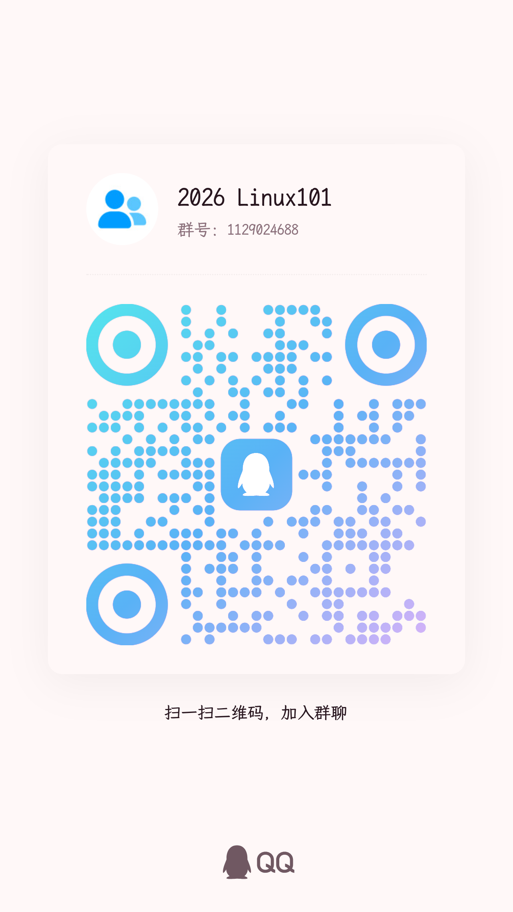

**震惊瘫坐，宛如见到原子弹爆炸？！** Linux 101 带着最潮最酷的全新内容回归了！

无论你是开源社区的大手子，还是“啥也不会”的小资历，都欢迎一起探索自由软件、Linux 发行版、AI 工具使用与开源协作等六大主题。从认识 Linux 到亲手实践，从学会使用工具到参与真实项目，这次我们一起动手，把好奇变成技能。

震惊瘫坐，宛如见到原子弹爆炸？！最新最热的Linux101带着最潮最酷的全新内容回归了，无论是开源社区大手子，还是啥也不会的小资历，都能围绕自由软件，Linux发行版，ai使用等六大主题一同进行探索。期间更有免费token等大量配套教学资源提供，心动不如行动，现在就开启这场Linux101之旅！

## 报名与参与

心动不如行动，**[现在填写报名问卷，开启这场 Linux 101 之旅 →](https://wj.qq.com/s2/28152478/mmqs/)**

课程期间更有 **免费 token** 等丰富的配套教学资源。**配套课程资源须填写在线表格后领取。**

本页面起始日期为报名开放日期（10 月 11 日）。**第一讲将于 10 月 17 日 18:45 在 T3201 举行，由社员寅默主讲请。** 后续场次安排以活动通知为准。

扫码加入 **2026 Linux101 QQ 群（群号：1129024688）**，获取课程通知并参与交流。

## 六讲课程大纲

### 第一讲：自由软件、开源与 Linux 入门

建立 Linux 世界观，理解自由软件、开源与 Linux 的来龙去脉。

- 自由软件与开源：GNU 计划、自由软件运动、开源运动与许可证基本概念。
- Linux 历史：Unix、GNU、Linux Kernel 与 GNU/Linux 生态。
- 系统基本概念：硬件、内核、操作系统、用户空间、Shell、Terminal、桌面环境与应用程序。
- Linux 生态：发行版、软件包、包管理器、桌面环境与服务器；比较 WSL、虚拟机与物理机。
- **实践**：通过 SSH 登录真实的 Linux 主机，浏览目录、切换路径，并在练习目录中尝试创建和删除文件。

### 第二讲：AI 时代的技术学习与问题解决

培养 AI 时代的计算机学习方法，为后续 Linux 学习提供辅助能力。

- AI 基础：LLM、Token、Context、模型差异与 Chat / Agent / API。
- 如何描述环境、目标、错误信息与已有尝试，为 AI 提供有效上下文。
- 用 AI 辅助安装软件、分析报错、阅读文档与理解命令。
- 判断输出是否可靠，理解 sudo、权限与系统修改风险，避免盲目复制命令。
- 问题解决流程：阅读错误 → 搜索文档 → AI 辅助 → 验证结果；学习 Issue、论坛与社群提问规范。
- **实践**：分析错误日志、阅读 Linux 文档，比较不同提问方式，并尝试解决环境问题。AI 是辅助工具，不替代独立思考。

### 第三讲：Linux 使用与生态实践

从概念进入实际使用，建立日常使用 Linux 的能力。

- 命令行基础：Terminal、Shell、bash / zsh，以及 `pwd`、`ls`、`cd`、`mkdir`、`cp`、`mv`、`rm`、`cat` 等常用命令。
- 文件系统：目录结构、绝对路径、相对路径与 `/home`、`/etc`、`/usr`。
- Shell 思维：管道、重定向与小工具组合。
- 软件管理：软件包、依赖、软件源与 apt；了解不同发行版的生态差异。
- Linux 个性化：Shell 配置、终端美化、编辑器与桌面环境体验。
- **实践**：完成基础操作任务，修改软件源、安装常用软件并配置个人终端环境。

### 第四讲：Git、开源协作与社区参与

从个人使用 Linux 走向开源开发与协作。

- 版本控制与 Git 基础：repository、commit、branch、merge、remote。
- 协作流程：clone、pull、push 与 Pull Request。
- 阅读开源项目：README、LICENSE、CONTRIBUTING 与 Issue。
- 开源贡献方式：代码、文档、翻译、测试与 Bug 提交。
- 技术交流：如何写 Issue、如何向社区提问。
- **实践**：创建 Git 仓库、完成 commit，并尝试通过 Pull Request 修改开源项目文档或示例。

### 第五讲：Linux 系统基础与服务器世界

从“使用 Linux”深入理解 Linux 如何运行。

- 用户与权限：用户、用户组、sudo 与文件权限。
- 进程管理：程序、进程、后台运行与 PID。
- 系统服务：systemd、服务启动与日志查看。
- 网络基础：IP、端口、DNS 与 SSH。
- 服务器生态：云服务器、虚拟机、镜像站与远程运维，结合协会基础设施介绍服务器、镜像站与监控系统。
- **实践**：SSH 登录服务器，查看进程、服务状态并分析日志。

### 第六讲：容器、部署与现代 Linux 生态

连接 Linux 基础与现代工程实践，理解软件如何从代码变成服务。

- 环境隔离：虚拟机与容器的区别。
- Docker 基础：Image、Container 与 Registry。
- 软件部署流程：代码 → 依赖 → 环境 → 服务 → 日志。
- 开源软件运行：阅读 README、配置环境与启动服务。
- 现代基础设施：Docker、CI/CD、Kubernetes 与可观测性，结合镜像站、Docker 加速与服务器部署案例介绍。
- **实践**：运行 Docker 容器，修改配置、启动服务并查看日志，体验简单部署流程。
