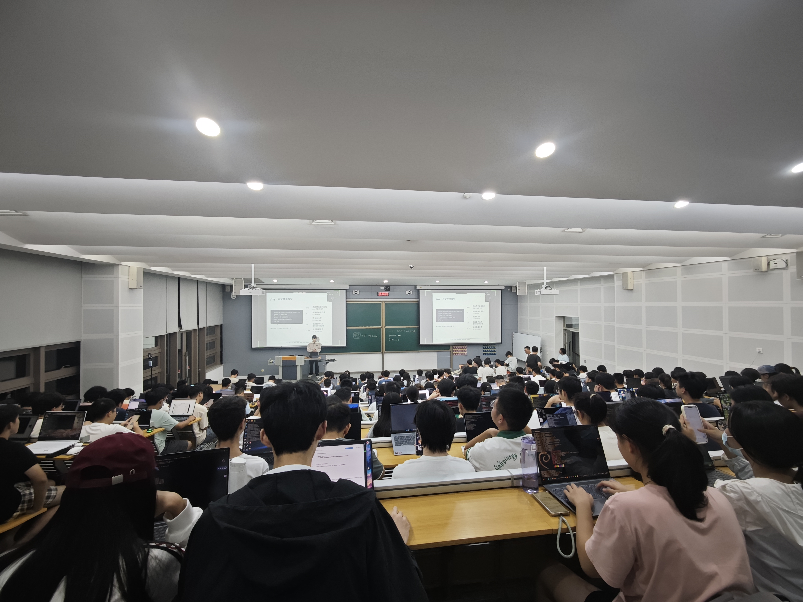
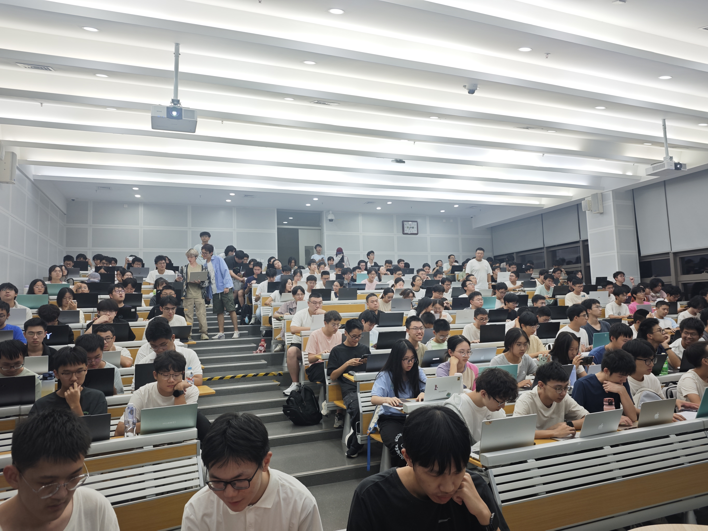
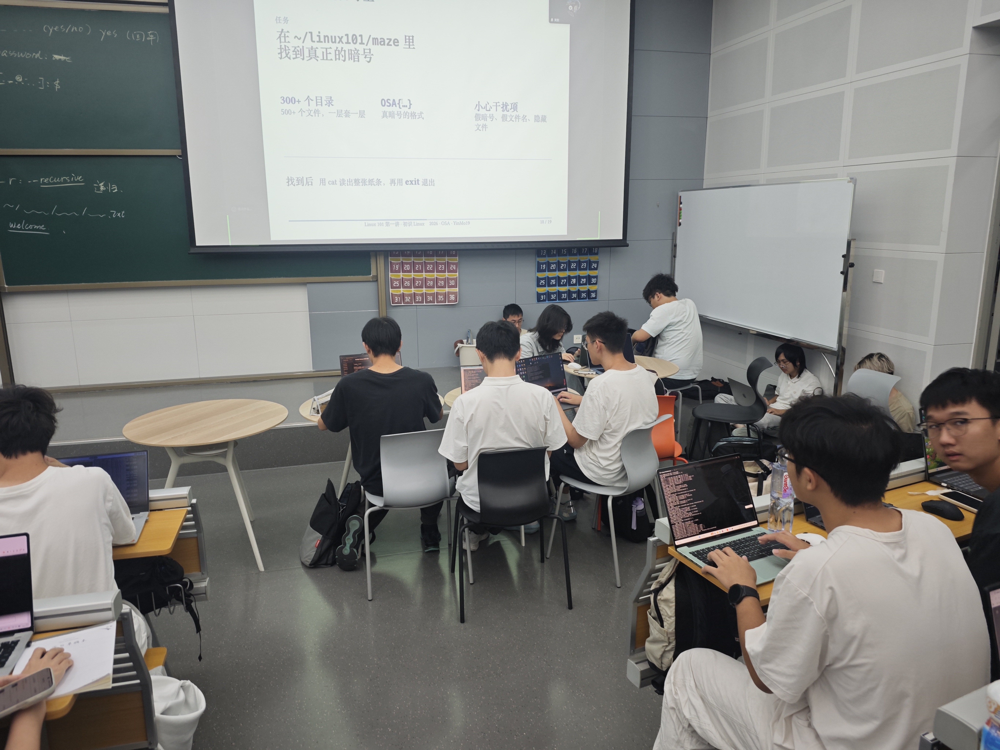
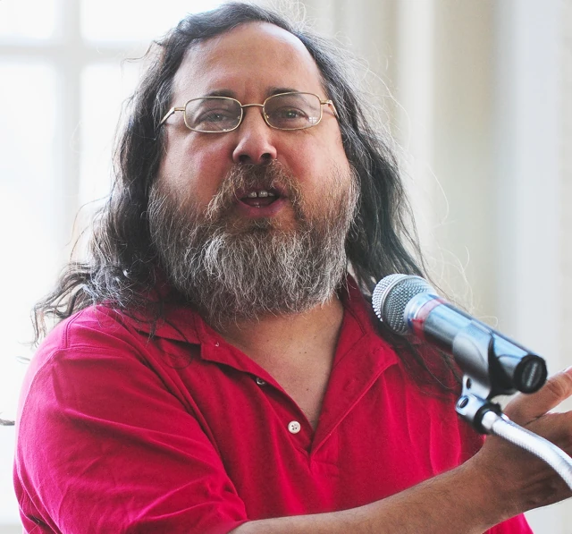
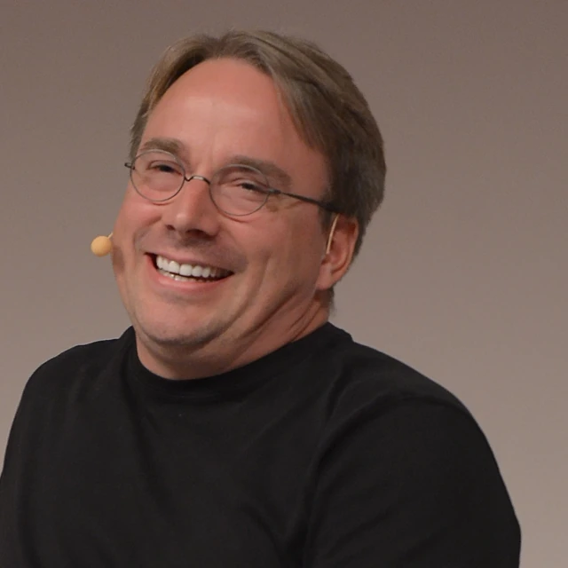
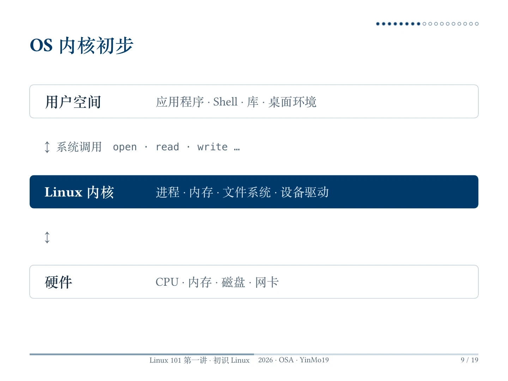
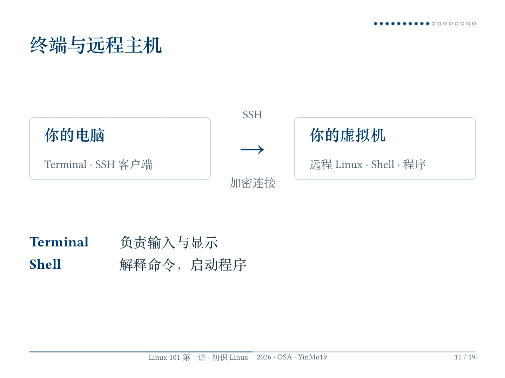
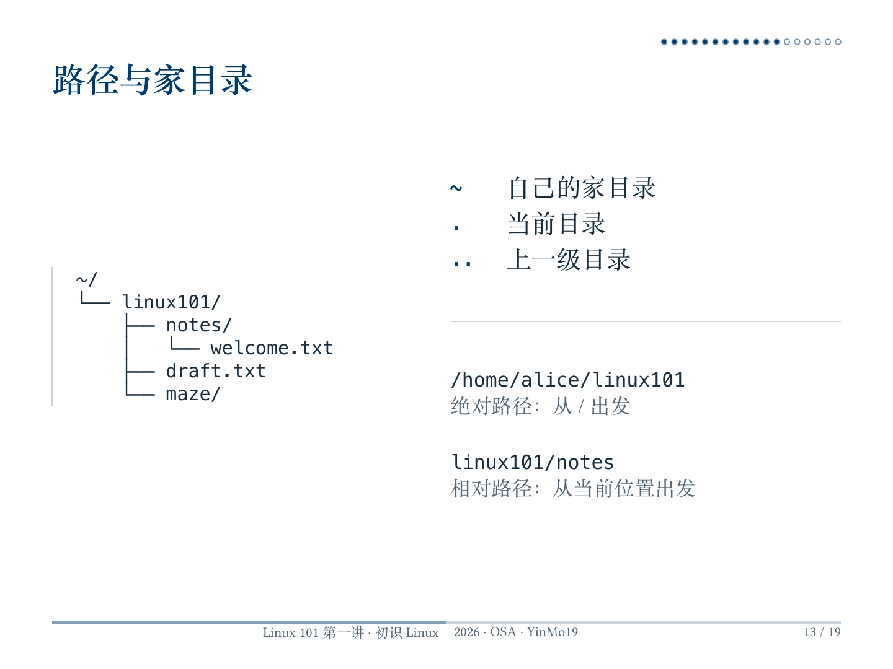
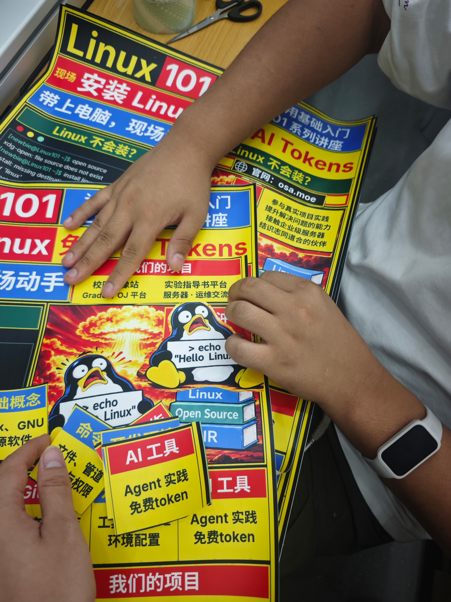

import BilibiliVideo from '../../../../../apps/landing/src/components/content/BilibiliVideo.astro';

10 月 17 日晚，Linux 101 第一讲在 T3201 顺利结束！

本讲由寅默同学主讲，首先讲述了 GNU/Linux 的历史、自由软件运动与开源软件的来龙去脉，然后带同学们进行了第一次 Linux 实操体验。在讲座最后，由社员提供帮助，为有需求的同学们安装了wsl和虚拟机。





讲座前我们完全低估了大家的积极性。根据往年的经验，180 人的阶梯教室应该是绰绰有余，但今年由于宣传力度更大（涵盖课程群、老师同学朋友圈）、同学们更积极，教室居然坐满了。至此 Linux101 已经成为学校参与人数最多、最积极的*非被迫参与*的讲座。为了给同学们腾出座位，社员们只有搬来门口自习用的桌椅，在过道和讲台边席地而坐。~~一群人抱着电脑坐在地上倒也挺有技术社团的氛围~~



## 讲座录播

<BilibiliVideo bvid="BV16enb6NETk" title="HITsz OSA Linux 101 第 1 讲" />

## 讲座内容

这一讲的目标**不是**背下一串命令，**而是**先弄清楚 Linux 从哪里来、系统里各部分负责什么，再连接一台 Linux 主机，完成第一次终端操作。以下内容来自寅默同学的课件。

### 从 Unix 到 GNU/Linux

Linux 并不只存在于程序员的电脑上。Android 手机使用 Linux 内核，网站背后的服务器、云服务以及超级计算机也大量依赖 Linux。即使没有主动安装过它，我们也早已在使用它支撑的服务。

故事可以从 **1969 年贝尔实验室的 Unix** 讲起。Ken Thompson、Dennis Ritchie 等人参与开发的这个系统，留下了不少延续至今的传统：一台机器可以让多个用户同时运行不同任务；文件组织在统一的目录树中；小工具各做好一件事，再相互组合。Linux 继承了许多 Unix 的设计思想，但并不是把原来的 Unix 源代码换个名字。

1983 年，Richard Stallman 宣布 **GNU 计划**，并于 1984 年开始开发，目标是构建一套自由的类 Unix 操作系统。GNU 是“GNU's Not Unix”的递归缩写。这里的“自由”重点不是价格为零，而是用户能够掌握自己使用的软件。

<div style="max-width: 320px; margin-inline: auto;">



</div>

课件介绍了自由软件的四项自由：

- **自由 0：运行**程序，用于任何目的。
- **自由 1：研究与修改**程序，让它按自己的需要工作。
- **自由 2：分发副本**，帮助其他人。
- **自由 3：分发修改后的版本**，让其他人也受益。

研究和修改离不开源代码，但**能看到源码，并不自动意味着拥有这些权利**，具体还要看许可证。1998 年，“Open Source（开源）”这一称谓开始推广。自由软件与开源软件有大量重叠，前者更强调用户的自由，后者更强调开放源码的开发与协作方式；都不能简单理解成“免费软件”。GPL、MIT、Apache 等许可证规定了使用、修改和分发的条件，参与项目时也需要遵守各自要求。

1991 年，21 岁的 Linus Torvalds 在赫尔辛基大学读书时发布了自己的内核项目，在邮件中把它称为“只是一个爱好”。1992 年，Linux 改用 GPL；1993 年，Debian、Slackware 等发行版相继出现。

<div style="max-width: 320px; margin-inline: auto;">



</div>

**GNU 提供编译器、Shell、库等工具，Linux 提供内核，两者与其他软件一起构成了可用的 GNU/Linux 系统。** 日常说“装 Linux”往往指安装这样一套系统；严格说，Linux 本身是内核的名字。

### 内核、发行版与桌面，分别是什么？

可以把电脑上的系统粗略分成三层：

- **硬件**：CPU、内存、磁盘、网卡等实际设备。
- **内核**：管理进程、内存、文件系统和设备驱动，协调程序对硬件资源的使用。
- **用户空间**：应用程序、Shell、库、桌面环境等我们直接或间接使用的软件。

应用通常通过系统调用请求内核提供服务，例如打开文件、读取和写入数据。我们在终端里输入命令，并不是直接对 CPU 或磁盘下指令，中间还有 Shell、程序和内核的配合。



单有内核还不够方便日常使用。**发行版**将内核、软件包、包管理器和默认配置组织在一起，提供安装、更新和维护系统的方式。Ubuntu、Debian、Fedora、Arch 都是发行版。

**桌面环境**则负责窗口、面板等图形交互，GNOME、KDE Plasma 都是常见选择。发行版不等于桌面环境：同一个发行版可以使用不同桌面，也可以完全不安装桌面。许多服务器只有终端，照样能运行网站和其他服务。

### Terminal、Shell 与 SSH：先分清你在操作哪台电脑

这三个词经常一起出现，但不是同一个东西：

- **Terminal（终端）**负责接收键盘输入、显示文字输出，是我们与命令行交互的窗口。
- **Shell**负责解释命令、启动程序，常见的有 Bash、Zsh。
- **SSH**提供加密的远程连接，让我们从自己的电脑登录另一台主机。

因此，本机打开终端并通过 SSH 登录后，输入的命令通常是在**远端 Linux 环境**执行，而不是在修改自己的 Windows 文件。课件将远端环境称为虚拟机，本次现场准备的是练习用容器；就这一步而言，都是登录分配给自己的 Linux 环境。



连接命令的形式如下，账号、地址和端口要换成实际分配的信息：

```text
ssh 账号@主机地址 -p 端口
```

第一次连接时，应当向组织者核对主机指纹，一致后再确认，不能看到提示就直接输入 `yes`。输入登录密码时，终端通常**不显示字符，也不显示星号**，正常输入后按回车即可。练习结束后使用 `exit` 退出远程会话。

### 目录与路径：先知道自己在哪里

Linux 的文件系统从**根目录 `/`** 开始，不像 Windows 那样通常以 `C:`、`D:` 作为不同盘符入口。课件介绍了几个常见目录：

- `/home`：普通用户家目录通常所在的位置。
- `/etc`：系统配置。
- `/usr`：大量程序与共享资源，并不是普通用户的家目录。
- `/var`：日志等经常变化的数据。
- `/tmp`：临时文件，不适合存放需要长期保留的资料。

路径也有两种写法：**绝对路径**从 `/` 开始，如 `/home/alice/linux101`；**相对路径**从当前位置开始，如 `notes/welcome.txt`。其中 `~` 表示当前用户的家目录，`.` 表示当前目录，`..` 表示上一级目录。家目录 `~` 和根目录 `/` 不是一回事。



在已提供课程练习文件的环境中，可以按下面的顺序走一遍：

```sh
pwd
ls
cd ~/linux101
ls
cd notes
pwd
ls
cd ..
```

`pwd` 回答“我在哪”，`ls` 回答“这里有什么”，`cd` 负责“去哪里”。如果提示找不到 `~/linux101`，先确认是否登录了课程环境、练习文件是否已准备好，不必急着照抄后面的命令。

### 从查看文件，到搜索线索

进入 `~/linux101` 后，可以使用 `cat` 阅读文件，用 `grep` 找出包含关键词的行：

```sh
cat notes/welcome.txt
grep Welcome notes/welcome.txt
grep -r Welcome .
grep -ri welcome .
ls -a
```

第一条命令打印整个文件；第二条只显示含 `Welcome` 的行。`grep` 的 `-r` 表示递归搜索子目录，`-i` 表示忽略大小写，最后的 `.` 指定从当前目录开始搜索。搜索多个文件时，输出通常会带上文件路径，方便继续追查。

普通 `ls` 默认不显示以 `.` 开头的名字，`ls -a` 可以把这些隐藏文件和目录也列出来。“隐藏”只是默认不展示，不意味着它们不存在或无法访问。

课件还演示了用 `rm draft.txt` 删除练习目录里的草稿文件。这里最重要的不是记住命令，而是记住：**`rm` 通常不会把文件放进回收站。** 操作前先用 `pwd`、`ls` 核对位置和文件名，只删除课程明确提供的练习文件，不要拿重要资料试手。

### maze：用刚学到的工具找到真正的暗号

课件最后安排了迷宫寻宝：在 `~/linux101/maze` 中，从三百多个目录、五百多个文件里找到真正的暗号。目标格式是 `OSA{…}`，但里面还藏着假暗号、干扰文件名与隐藏文件。

这不是要求大家手动打开每个文件，而是尝试把工具组合起来：先用 `pwd` 确认位置，用 `ls -a` 观察目录，再用 `grep -r` 搜索线索；找到候选文件后，**用 `cat` 读完整张纸条**，结合上下文判断真假，而不是看到一个符合格式的字符串就宣布通关。完成后，用 `exit` 退出。

这一关把“目录是什么”“相对路径从哪里算起”“如何查找文字”串成了一次实际任务。比起背命令，知道遇到问题时该选哪个工具，才是这次练习的重点。

### 把 Linux 带回自己的电脑

远程体验之外，课件也介绍了本地安装的入口。符合条件的 Windows 10（2004 及以上版本）或 Windows 11 用户，可以使用 **WSL** 在 Windows 中运行 Linux 环境，不必每次重启切换系统。

课件以 Debian 为例：在管理员 PowerShell 中执行以下命令，按提示完成安装并重启，然后从开始菜单打开 Debian，创建 Linux 用户名和密码。

```powershell
wsl --install -d Debian
```

现场社员还协助同学们安装了**虚拟机**：在宿主系统中运行另一套操作系统，适合隔离体验。另一种选择是**双系统**，让 Windows 与 Linux 分别安装，开机时选择进入哪个系统；它涉及磁盘分区与引导设置，安装前务必备份重要文件，不确定时先找社员协助。

第一讲不要求大家立即选出“最好的发行版”，也不要求一次装好所有环境。能分清基本概念、登录练习环境，并用几个命令完成浏览与查找，就已经迈出了第一步。

理论和演示之外，现场的社员们也没闲着，一直在台下帮同学们安装 WSL 和虚拟机，处理各种五花八门的报错。讲座最后，我们给到场的同学分发了贴纸和钥匙扣，算是一点开门见山的小纪念。

## 几个小遗憾与现场事故

比起顺利完成的部分，这次活动其实暴露了不少准备和环境上的问题：

**1. 准备好的容器没能全员发出去**  
课前我们其实为同学们搭建了练习用的虚拟容器，但发放环节不太顺畅。一部分同学没收到通知邮件，还有一些同学事先没填收集表，导致现场没能及时拿到环境。

需要练习环境的同学，请记得补填一下这份[在线表格](https://wj.qq.com/s2/28152478/mmqs/)，后续我们会根据表单继续发放。（从第二讲开始，我们便将会为填写了表单的同学们发放免费token）

**2. 糟糕的教室网络**  

当晚最大的阻碍来自教室的网络环境。现场 SSH 连接非常缓慢，下软件也很折磨。应当是由于达到了AP的最大连接数。

虽然我们提前在校内镜像站做好了对应的软件镜像，但现场很快遇到了一个很尴尬的悖论：连校园网，网速卡得几乎动不了；切到手机流量，网速倒是快了，但又访问不了仅限内网的镜像站。这也让我们深刻意识到一个问题——光有校内镜像还不够，我们真的很需要公网访问。公网目前还正在和学校battle中。

**3. 现场patch（物理）**  

由于一些不可抗力，原本为第一讲准备的宣传海报在活动前没能贴出来。好在讲座结束后，我们已经把海报的问题紧急 patch 完毕了。如果顺利的话，大家过两天应该就能在校园里看到这张宣传海报了。



---

总之，感谢来捧场的各位，也辛苦现场忙前忙后的社员们。下周见。
